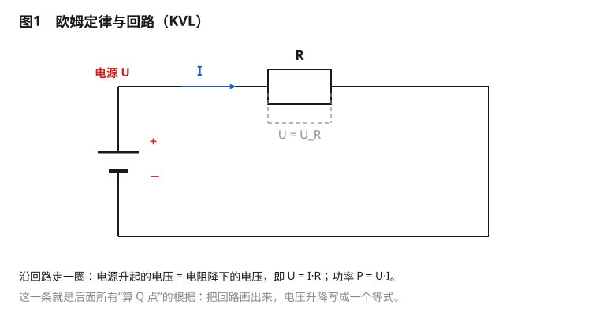
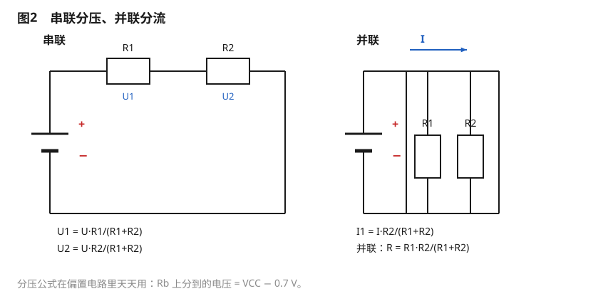

# 01 · 电学基础

> 电压、电流、电阻、欧姆定律、串并联、KVL。这一篇是后面所有内容的地基。

## 1. 电压、电流、电阻



| 量 | 含义 | 单位 | 类比 |
|---|---|---|---|
| 电压 U | 两点之间的电势差 | V（伏特） | 水位差 |
| 电流 I | 单位时间流过的电荷量 | A（安培） | 水流 |
| 电阻 R | 对电流的阻碍 | Ω（欧姆） | 水管粗细 |

**欧姆定律**：

```
U = I·R        I = U/R        R = U/I
```

单位换算（代入公式前统一成 V、A、Ω）：

```
1 kΩ = 1 000 Ω      1 mA = 0.001 A      1 μA = 0.000001 A
```

例：12 V 加在 300 kΩ 上，`I = 12 / 300000 = 40 μA`。

**功率**：

```
P = U·I = I²R = U²/R
```

## 2. 串联、并联、分压



| | 电流 | 电压 | 等效电阻 |
|---|---|---|---|
| 串联 | 处处相同 | 分配：`U1 = U·R1/(R1+R2)` | `R = R1 + R2` |
| 并联 | 分配：`I1 = I·R2/(R1+R2)` | 处处相同 | `R = R1·R2/(R1+R2)` |

分压公式在偏置电路里天天用：放大电路的 Rb 上分到的电压就是 `VCC − 0.7 V`。

## 3. 回路与 KVL、KCL

**KVL（基尔霍夫电压定律）**：沿任意闭合回路走一圈，电压升之和 = 电压降之和。

用图 1 那条回路写一遍：

```
电源升起 U → 电阻降下 U_R → 回到起点
U = U_R = I·R
```

使用要点：

1. 先在图上画出闭合回路；
2. 电源算"升"，电阻、二极管、三极管两端算"降"；
3. 放大电路里固定画两个圈：输入回路（VCC→Rb→B→E→地）和输出回路（VCC→Rc→C→E→地）。

**KCL（节点电流定律）**：流入一个节点的电流之和 = 流出之和。分析放大电路基本用不到，知道即可。

## 4. 电源与地

- **理想电压源**：端电压恒定，内阻为 0。实际电源有内阻，带负载时输出电压会掉。
- **理想电流源**：输出电流恒定，内阻无穷大。
- **地（GND）**：电压的参考零点，不是"大地"。
- **为什么交流分析时 VCC 当作地**：理想电压源端电压不变，对交流来说没有电压变化，等价于两端短路到地。这是后面画交流通路的依据。

## 5. 测试里对应什么

| 场景 | 用到的概念 |
|---|---|
| PMU 强制电压、测电流 | 欧姆定律：`I = U/R`；测的是 DUT 端口电流 |
| 开短路测试 | 电流异常大 = 短路；电流几乎为 0 = 开路 |
| 四线开尔文测量 | 线阻和接触电阻会被算进电压降，force/sense 分开可消除 |
| 测漏电流 | 电流小到 nA 级，必须用高阻档，量程与噪声都要考虑 |
| 负载效应 | 输出电阻与负载分压，测得的值不是"空载值" |

## 6. 自检

1. 5 V 加在 4.7 kΩ 上，电流多少？
2. 12 V 经 10 kΩ 与 20 kΩ 串联，20 kΩ 上的电压多少？
3. 为什么交流分析时可以把 VCC 看成地？

<details><summary>答案</summary>

1. `5/4700 ≈ 1.06 mA`。
2. `12 × 20/(10+20) = 8 V`。
3. 理想电压源端电压恒定，对交流没有电压变化，两端等价于短路到地。

</details>
