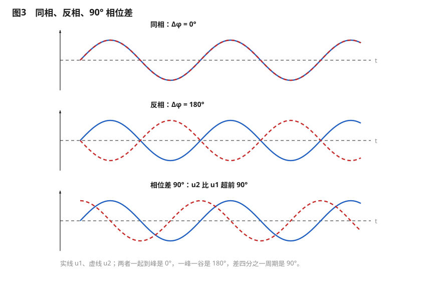
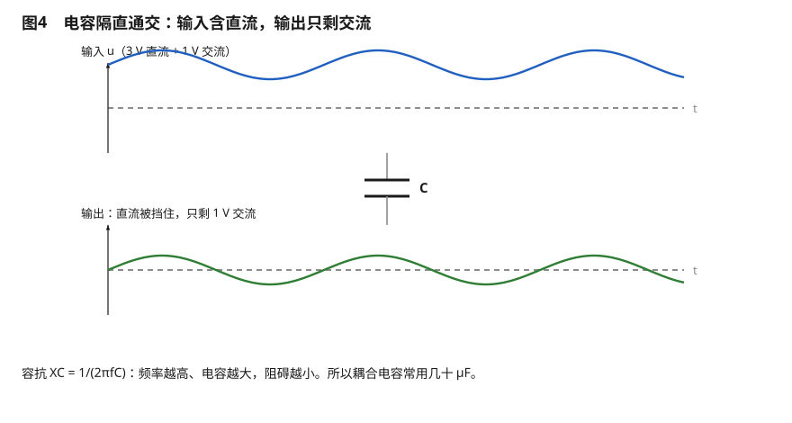

# 02 · 信号与电容

> 直流、交流、正弦波、相位、电容。放大电路里"交流通路"和"耦合电容"都靠这一篇。

## 1. 直流与交流

| | 直流 DC | 交流 AC |
|---|---|---|
| 特征 | 大小方向不变 | 大小方向周期性变化 |
| 来源 | 电池、电源 | 信号源、振荡器 |
| 符号 | 大写 `U`、`I` | 小写 `u`、`i`（瞬时值） |

放大器里两者共存：

```
uBE = UBEQ + ube      总电压 = 直流偏置 + 交流信号
iC  = ICQ  + ic
uCE = UCEQ + uce
```

- 大写带 Q 下标：静态值（没有信号时的值）
- 小写：瞬时总量
- 小写带下标：纯交流分量

## 2. 正弦波与相位



正弦波三个参数：

| 参数 | 含义 | 关系 |
|---|---|---|
| 幅值 Um | 峰值 | — |
| 峰峰值 Upp | 最高到最低 | `Upp = 2Um` |
| 有效值 Urms | 与直流等效发热的量 | `Urms = Um/√2 ≈ 0.707Um` |
| 频率 f / 周期 T | 每秒周期数 / 一个周期时间 | `T = 1/f` |

**相位差**：两个同频正弦"谁先到峰"。

- 一起到峰、一起到谷 → 0°（同相）
- 一个到峰、另一个正好到谷 → 180°（反相）
- 差四分之一周期 → 90°

示波器判断：两条曲线过零点同时同向 = 同相；峰谷相对 = 反相。

## 3. 电容



- 电荷与电压：`Q = C·U`
- 电流与电压变化率：`i = C·du/dt`——电压不变时电流为 0
- 容抗：`XC = 1/(2πfC)`

**两个关键性质**：

1. **隔直通交**：直流充满后不再有电流；交流不断充放电，电流持续存在。
2. **电容两端电压不能突变**：所以它能"锁住"一个直流电平。

**RC 充放电**：时间常数 `τ = R·C`，约 `3τ~5τ` 充满。这也是上电复位、去耦、滤波的基础。

**电感**：通直阻交，感抗 `XL = 2πfL`，一句话记住即可。

## 4. 测试里对应什么

| 场景 | 用到的概念 |
|---|---|
| AC 参数测试 | 增益、带宽、相位裕度、传播延迟，测的都是频率与相位 |
| 示波器 DC/AC 耦合 | DC 耦合看到"直流+交流"，AC 耦合只看到交流 |
| 耦合电容选择 | 容抗要远小于电路阻抗，否则低频增益下降 |
| 上升时间 | 边沿越快，高频成分越多，对带宽和探头要求越高 |
| 去耦电容 | 靠近芯片放置，给瞬态电流提供本地回路 |

## 5. 自检

1. 峰值 2 V 的正弦，峰峰值和有效值是多少？
2. 示波器 AC 耦合下，uCE 的中心在 0 V，正常吗？
3. 为什么耦合电容要用几十 μF，而不是 100 pF？

<details><summary>答案</summary>

1. 峰峰值 4 V，有效值 `2/√2 ≈ 1.41 V`。
2. 正常，AC 耦合把直流成分滤掉了。
3. 容抗 `1/(2πfC)` 要足够小，音频 20 Hz 时 100 pF 的容抗高达 MΩ 级，等于断路。

</details>
