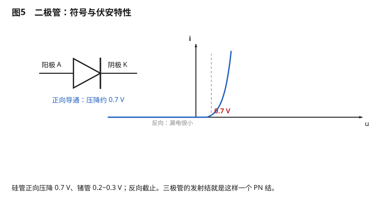
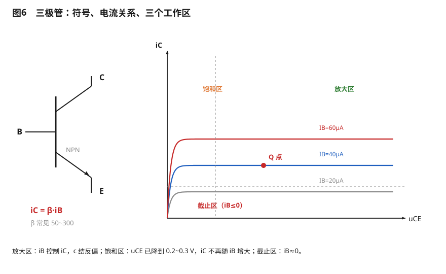

# 03 · 半导体器件

> 二极管、三极管、MOS 管。测试里几乎每一项 DC 参数都落在这三种器件上。

## 1. 二极管



- 结构：一个 PN 结，P 端叫阳极（A），N 端叫阴极（K）。
- 正向导通：硅管压降约 0.7 V，锗管 0.2~0.3 V。
- 反向截止：只有很小的漏电流，超过反向击穿电压会击穿。
- 用欧姆定律算电流时要先把 0.7 V 扣掉：`I = (U − 0.7)/R`。

**测试项**：正向压降 VF、反向漏电 IR、反向击穿电压 VR。ESD 保护二极管是芯片每个 IO 上最常见的一对二极管。

## 2. 三极管（BJT）



三个极：基极 B、集电极 C、发射极 E。箭头朝外是 NPN，朝里是 PNP。

**电流关系**：

```
iC = β·iB        iE = iC + iB = (1+β)·iB
```

β 常见 50~300，同一型号个体差异很大，且随温度变化。

**三个工作区**：

| 工作区 | 条件 | 表现 | 用途 |
|---|---|---|---|
| 截止 | uBE < 0.5 V 左右 | iB≈0，iC≈0 | 开关"断开" |
| 放大 | 发射结正偏、集电结反偏 | iC 按 β 跟随 iB | 放大电路 |
| 饱和 | 两个结都正偏，uCE ≈ 0.2~0.3 V | iC 不再随 iB 增大 | 开关"闭合" |

**温度影响**：UBE 约 −2 mV/℃，β 随温度升高，漏电流 ICBO 增大。三者叠加使 ICQ 升高——这就是固定偏置电路 Q 点漂移的原因。

## 3. MOS 管

- 电压控制器件：栅极电压 uGS 控制漏极电流 iD，栅极几乎不取电流（输入阻抗极高）。
- 阈值电压 Vth：`uGS > Vth` 才导通（NMOS）。
- 三个区：截止（uGS < Vth）、线性/可变电阻区（uDS 小，iD 随 uDS 线性变化）、饱和区（iD 基本由 uGS 决定）。
- **CMOS 反相器**：PMOS 接电源、NMOS 接地，栅极并联作输入。静态时总有一个管子截止，所以几乎不耗电——这是 CMOS 省电的原因。

| | 三极管 BJT | MOS |
|---|---|---|
| 控制量 | 基极电流 iB | 栅极电压 uGS |
| 输入阻抗 | 低（rbe 千欧级） | 极高（栅极绝缘） |
| 噪声 | 较低 | 有 1/f 噪声与栅极噪声 |
| 常见工艺 | 双极工艺 | CMOS 主流 |

## 4. 测试里对应什么

| 器件 | 常见测试项 | 说明 |
|---|---|---|
| 二极管 | VF、IR、VR | 正向压降、反向漏电、击穿电压 |
| 三极管 | hFE、VCE(sat)、VBE(on)、ICBO | 电流增益、饱和压降、导通压降、漏电 |
| MOS | Vth、Idss、Rds(on)、Igss | 阈值、漏电流、导通电阻、栅极漏电 |
| 通用 | 开短路、IDDQ | 供电电流异常说明内部短路或漏电 |

这些参数都是在**特定偏置条件**下测的，datasheet 里一定注明测试电压、电流和温度，读数时必须对条件。

## 5. 自检

1. 硅二极管串 1 kΩ 接 5 V，电流多少？
2. β=100、IB=20 μA 时，IC 和 IE 各是多少？
3. 为什么 CMOS 反相器静态几乎不耗电？

<details><summary>答案</summary>

1. `(5−0.7)/1000 = 4.3 mA`。
2. IC = 2 mA，IE = IC + IB = 2.02 mA。
3. 输入为高或低时，总有一个管子截止，电源到地没有直流通路。

</details>
