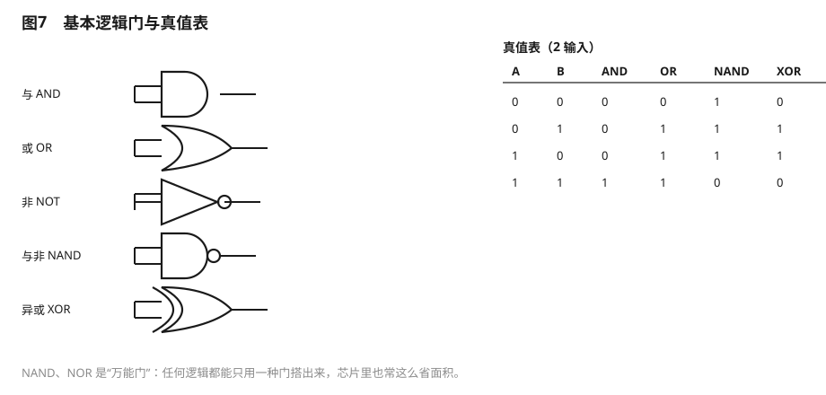
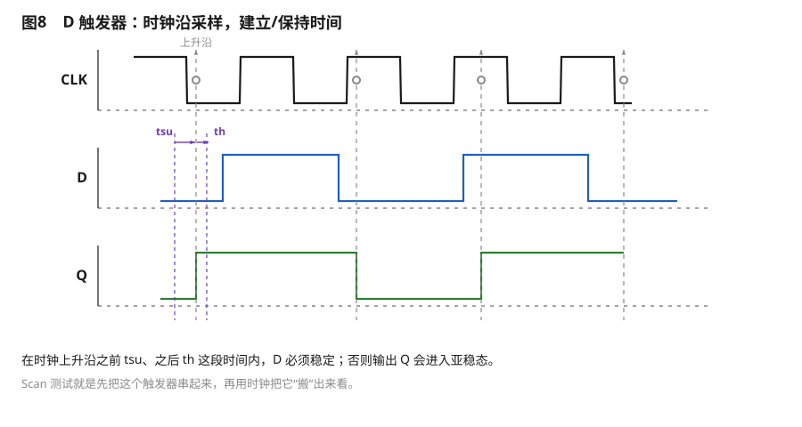

# 04 · 数字逻辑

> 逻辑门、组合逻辑、时序逻辑、触发器。功能测试和 Scan 测试全部建立在这一篇。

## 1. 逻辑电平

数字电路用两个电压区间表示 0 和 1（正逻辑）：

| | 含义 | 典型 |
|---|---|---|
| 高电平 | 逻辑 1 | 接近电源电压 |
| 低电平 | 逻辑 0 | 接近 0 V |

具体门限（VIL/VIH/VOH/VOL）见 [05-测试相关概念](05-测试相关概念.md)。

## 2. 逻辑门



| 门 | 表达式 | 一句话 |
|---|---|---|
| 与 AND | `Y = A·B` | 全 1 才出 1 |
| 或 OR | `Y = A+B` | 有 1 就出 1 |
| 非 NOT | `Y = A̅` | 取反 |
| 与非 NAND | `Y = (A·B)‾` | 与后取反，**万能门** |
| 或非 NOR | `Y = (A+B)‾` | 或后取反，也是万能门 |
| 异或 XOR | `Y = A⊕B` | 不同出 1 |

布尔代数两条最常用的：

```
德摩根： A+B‾ = A̅·B̅      A·B‾ = A̅+B̅
```

任何逻辑都可以只用 NAND 或只用 NOR 搭出来，芯片里常这么做来省面积和工艺步骤。

## 3. 组合逻辑

- 输出只取决于当前输入，**没有记忆**。
- 常见电路：加法器（半加/全加）、译码器、多路选择器 MUX、比较器。
- **竞争冒险**：输入变化经过不同路径延迟不同，输出会出现窄毛刺。消除方法是加冗余项或加采样时钟。

## 4. 时序逻辑



- 输出取决于当前输入**和历史状态**，必须有存储元件。
- 基本单元是触发器（flip-flop）：边沿触发，只在时钟沿采样。
- 锁存器（latch）是电平敏感，使能期间输出跟随输入。

**建立时间 tsu / 保持时间 th**：

```
时钟沿到来前 tsu 内、之后 th 内，数据必须稳定
违反 → 输出进入亚稳态（不定值、延迟不确定）
```

**其他常见结构**：寄存器（多个触发器并联）、移位寄存器、计数器、分频器、状态机（状态图 → 状态表 → 电路）。

**存储器**：

| 类型 | 特点 | 掉电 |
|---|---|---|
| SRAM | 快、面积大、贵 | 丢失 |
| DRAM | 密度高、需刷新 | 丢失 |
| Flash | 非易失、写入慢 | 保留 |

## 5. 测试里对应什么

| 场景 | 用到的概念 |
|---|---|
| 功能测试 | 给 Pattern，比较输出是否符合真值表/仿真结果 |
| Scan Chain | 把内部触发器串成移位寄存器，移入激励、移出响应 |
| BIST | 片内 LFSR 产生激励、MISR 压缩响应，自己判断对错 |
| 时序参数测试 | 建立/保持余量、最大频率、传播延迟 |
| 存储器测试 | March 算法遍历地址与数据图案 |

## 6. 自检

1. 用 NAND 门怎么实现 NOT？
2. 组合逻辑和时序逻辑最本质的区别？
3. 违反保持时间会怎样？

<details><summary>答案</summary>

1. 把 NAND 的两个输入接在一起当反相器。
2. 输出是否依赖历史状态（有无存储元件/时钟）。
3. 数据在时钟沿后变化太快，触发器可能采到新值或进入亚稳态，表现为随机错误。

</details>
