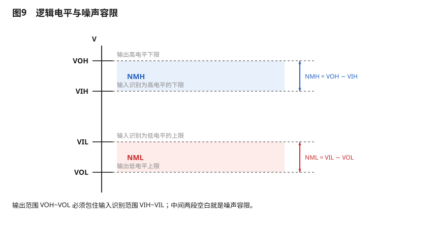
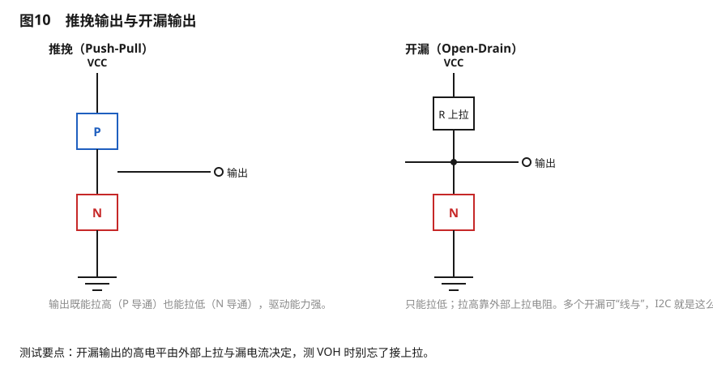

# 05 · 测试相关概念

> 电平标准、推挽与开漏、噪声与抖动。这些是"测什么、怎么判 Pass/Fail"的直接依据。

## 1. 逻辑电平与噪声容限



| 参数 | 含义 |
|---|---|
| VOH | 输出为高时的最小电压（驱动器保证） |
| VOL | 输出为低时的最大电压 |
| VIH | 输入被识别为高的最小电压 |
| VIL | 输入被识别为低的最大电压 |

**噪声容限**：

```
NMH = VOH − VIH        高电平还能容忍多少干扰
NML = VIL − VOL        低电平还能容忍多少干扰
```

判断标准：`VOH > VIH`、`VOL < VIL`，中间留的空白就是容限。测试时如果在边界附近读数，量测误差会直接造成误判，所以要留 guard band。

## 2. 推挽输出与开漏输出



| | 推挽 | 开漏 |
|---|---|---|
| 输出高 | 上管导通，主动拉高 | 上管不存在，靠外部上拉电阻 |
| 输出低 | 下管导通，主动拉低 | 下管导通，主动拉低 |
| 驱动能力 | 强 | 拉低强、拉高弱 |
| 多器件并联 | 不能（会短路） | 可以"线与"（I2C 就是这样） |
| 测 VOH | 直接测 | 必须接上拉，且高电平由上拉与漏电流决定 |

**上拉/下拉电阻**：给悬空节点一个确定电平。上拉太大，上升沿变慢；太小，功耗变大。

## 3. 输入输出特性

- **输入漏电 IIL/IIH**：输入脚在 0/1 电平时流进流出的微小电流，CMOS 通常在 nA~μA 级。
- **输出驱动 IOH/IOL**：输出能提供的最大电流，超过会掉电压。
- **负载效应**：输出有内阻，接上负载后电压会偏离空载值，测 VOH/VOL 时必须带规定负载。
- **三态输出**：使能脚关闭时输出高阻，多个器件可共享总线。

## 4. 噪声与定时

| 现象 | 来源 | 测试上的表现 |
|---|---|---|
| 串扰 | 相邻走线耦合 | 边沿出现台阶或过冲 |
| 地弹 | 大电流瞬间流过地线电感 | 参考电平抖动，误判 |
| 抖动 jitter | 时钟源、电源噪声 | 周期变化，时序余量变小 |
| 反射 | 阻抗不匹配、走线过长 | 过冲、振铃，采样点不稳 |

对应到测试：Shmoo 图上表现为某个电压/频率角落开始失效；Pin Margin 就是量"离失效还有多远"。

## 5. 三类测试与这些概念的对应

| 测试 | 测什么 | 本篇对应的概念 |
|---|---|---|
| DC 参数 | 电平、电流、阻抗 | VOH/VOL、IIL/IIH、开短路、驱动能力 |
| AC 参数 | 时间、频率、相位 | 上升时间、传播延迟、建立保持、抖动 |
| 功能测试 | 逻辑是否正确 | 逻辑门、真值表、时序、Pattern |

## 6. 常用仪器的用法

| 仪器 | 测什么 | 注意 |
|---|---|---|
| 万用表 | 电压、电流、电阻 | 测电流要串进去；测电阻要断电 |
| 示波器 | 波形、时间、相位 | 接地夹必须接；注意探头 ×1/×10 与带宽 |
| 信号发生器 | 提供激励 | 注意输出阻抗与幅度范围 |
| 直流电源 | 供电 | 注意限流设置，防止烧板 |
| SMU / PMU | 强制电压或电流并测量 | 四线接法消除线阻 |

## 7. 自检

1. 某器件 VOH=2.4 V、VIH=2.0 V、VIL=0.8 V、VOL=0.4 V，求 NMH 和 NML。
2. 开漏输出测 VOH 时，为什么必须接上拉？
3. 示波器看到的边沿有过冲和振铃，一般是什么原因？

<details><summary>答案</summary>

1. NMH = 0.4 V，NML = 0.4 V。
2. 开漏没有上管，不接上拉就没有拉高通路，输出只能是低或高阻。
3. 阻抗不匹配导致的反射，常见于走线过长或负载电容过大。

</details>
