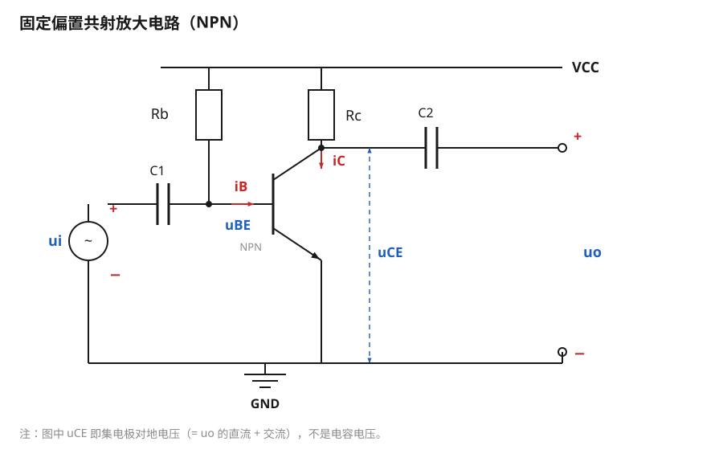
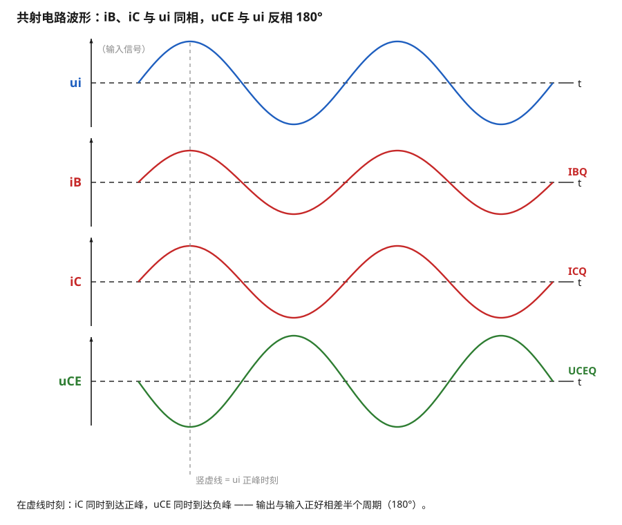
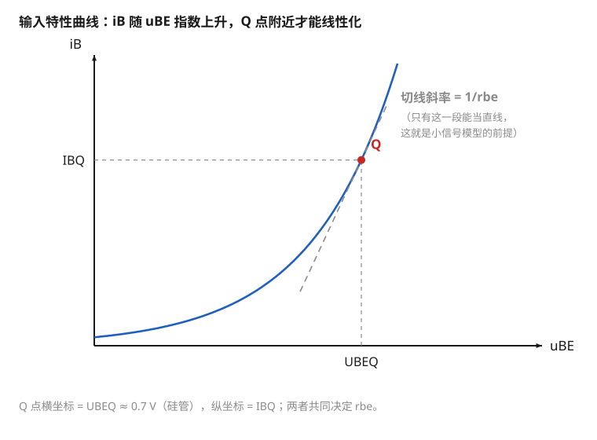
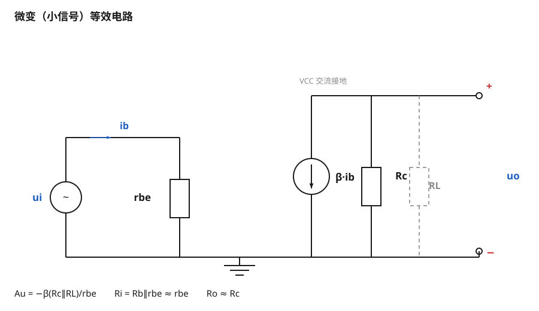

# 01 · 基本放大电路（固定偏置共射）

> 📚 所属：`01-电子基础 / 模拟电路`
> 🎯 前置：PN 结、三极管三种工作状态、Q 点概念
> 🧠 一句话记住：**偏置定 Q 点，Rc 把电流翻译成电压，C1/C2 隔直通交，共射必反相。**

---

## 0. 先看结论（复习时只看这一段）

| 问题 | 答案 |
|---|---|
| 这是什么电路 | NPN 管**固定偏置共射（CE）**放大电路 |
| 放大靠什么 | 三极管工作在**放大区**（发射结正偏、集电结反偏），iC = β·iB |
| 静态怎么算 | IBQ=(VCC−UBEQ)/Rb → ICQ=β·IBQ → UCEQ=VCC−ICQ·Rc |
| 动态怎么算 | uce = −Rc·ic，ic = β·ib，Au = −β(Rc∥RL)/rbe |
| 关键特征 | 输出与输入**反相 180°** |
| 最大隐患 | Q 点随温度/β 漂移 → 失真（后续用分压式偏置 + Re 解决） |

---

## 1. 电路识别：每个元件在干什么



| 元件 | 位置 | 作用 | 去掉会怎样 |
|---|---|---|---|
| VCC | 电源 | 提供能量与直流偏置 | 不放大（无偏置） |
| Rb | 基极→VCC | 提供基极偏置电流 IBQ，**定 Q 点** | 三极管截止，无 IBQ |
| Rc | 集电极→VCC | **电流→电压转换**（放大就发生在这一步） | 集电极直接接电源，uCE 恒为 VCC，无输出 |
| C1 | 信号源→基极 | 隔直通交：隔离信号源的直流，只让 ui 进来 | Q 点被信号源内阻破坏 |
| C2 | 集电极→负载 | 隔直通交：只让交流输出到负载 | 负载会把 Q 点拉走 |
| 三极管 | 核心 | 电流控制电流源：iC = β·iB | — |
| GND | 公共端 | "共射"的"共"：输入、输出都以发射极为参考 | — |

**一句话读懂电路图**：VCC 经 Rb 给基极"喂"一个恒定的 IBQ（偏置）→ 集电极电流 ICQ 在 Rc 上产生压降 → 得到一个稳定的 UCEQ（这就是 Q 点）→ 交流信号叠加上去，被 β 放大，再从 Rc 上取出来。

> ⚠️ 图上标的 `uC`（有些板书写作 `uCa`）严格说是 **uCE**，即集电极对地电压，不要和电容电压混淆。

---

## 2. 直流分析（静态）：求 Q 点

**直流通路**：电容 C1、C2 视为**开路**，交流源 ui 置零，只看 VCC、Rb、Rc、三极管。

基极回路的 KVL：

```
VCC = IBQ·Rb + UBEQ      →      IBQ = (VCC − UBEQ) / Rb
```

集电极回路 KVL：

```
ICQ = β·IBQ
UCEQ = VCC − ICQ·Rc
```

三个值定出 Q 点：**(UBEQ, IBQ)、(UCEQ, ICQ)**。UBEQ 硅管取 0.7 V（锗管 0.2~0.3 V），因为 0.7 V ≪ VCC，工程上常直接 `IBQ ≈ VCC/Rb`。

### 例题 1（动手算一遍，别只看）

已知 VCC = 12 V，Rb = 300 kΩ，Rc = 3 kΩ，β = 50，UBEQ = 0.7 V。

```
IBQ  = (12 − 0.7) / 300k   = 37.7 μA
ICQ  = 50 × 37.7 μA        = 1.88 mA
UCEQ = 12 − 1.88m × 3k     = 6.35 V
```

- UCEQ = 6.35 V，比饱和压降 UCE(sat)≈0.3 V 大得多 → **工作在放大区** ✅
- 空载时输出理论最大摆幅 ≈ min(UCEQ, ICQ·Rc) = min(6.35, 5.64) ≈ 5.6 V

---

## 3. 交流分析（动态）：为什么会反相

**交流通路**：C1、C2 视为**短路**，VCC 视为**交流接地**（内阻近似为 0）。

### 因果链（只背这一条）

```
ui ↑ → ube ↑ → ib ↑ → ic ↑ → uRc ↑ → uCE ↓ → uo ↓
```

### 用式子证明

```
uCE = VCC − Rc·iC
```

两边只取交流分量（VCC 是直流，求导为 0）：

```
uce = −Rc·ic,        ic = β·ib
=> uce = −β·Rc·ib
```

**负号 = 反相 180°**。物理原因只有一个：Rc 把"电流变大"翻译成"电压变小"（集电极电压被拉低）。

> 💡 反相不是三极管造成的，是**集电极电阻 Rc 造成的**。这也是共射（CE）与共集（CC，射极跟随，同相）、共基（CB，同相）最本质的区别。

---

## 4. 波形与相位对照表（重点）



### 4.1 波形对照表

| 量 | 围绕的直流值 | 与 ui 相位 | 幅度关系 | 削顶时"先削哪边" |
|---|---|---|---|---|
| uBE | UBEQ ≈ 0.7 V | 同相 | 很小（约几十 mV 峰峰） | 负半周被削 → 截止 |
| iB | IBQ | **同相** | 由输入特性曲线斜率（1/rbe）决定 | 负半周被削 → 截止 |
| iC | ICQ | **同相**（与 iB 同相） | ic = β·ib，放大 β 倍 | 正半周被削 → 饱和 |
| uCE（=uo） | UCEQ | **反相 180°** | uce = −Rc·ic | 正半周被削 → 截止；负半周被削 → 饱和 |
| uRc | ICQ·Rc | 与 iC 同相 | uRc = Rc·ic | 同 iC |

### 4.2 记忆口诀

```
iB、iC 顺，uCE 反；
Rc 一压，电就变。
输入变大输出小，一百八十跑不了。
```

### 4.3 示波器上怎么看到它们

| 想测谁 | 探头怎么接 | 注意 |
|---|---|---|
| ui | CH1 接输入端子对 GND | 注意探头衰减与直流偏置 |
| uo（uCE） | CH2 接集电极对 GND | 看到的是一条**绕 UCEQ 上下摆、与 ui 反向**的波形 |
| iC | 电流探头，或在 Rc 上串小电阻（如 100 Ω）测其压降 | 用欧姆定律换算，注意该电阻会改变 Q 点 |
| iB | 难直接测，一般串小电阻（如 1 kΩ）测压降，或用仿真 | 量级 μA，探头负载效应明显 |

> 双踪示波器同时看 ui 与 uo：把两条波形的**过零点对齐**，会发现峰值永远一上一下 —— 这就是 180°。

---

## 5. 输入特性曲线与 rbe



- iB–uBE 曲线是**指数型**：iB = IS·e^(uBE/UT)，UT ≈ 26 mV。
- Q 点横坐标是 **UBEQ**，纵坐标是 **IBQ**；曲线在 Q 点的斜率 = **1/rbe**。
- 只有 Q 点附近的**一小段**能当直线 → 这就是"**小信号**模型"成立的前提：信号幅度小到不会跑出这段直线。

工程估算：

```
rbe = rbb' + (1 + β)·26 mV / IEQ        (rbb' 一般取 200～300 Ω，IEQ ≈ ICQ)
```

例题 1 的数据：`rbe = 200 + 51 × 26m / 1.88m = 200 + 705 ≈ 905 Ω`。

> 💡 记忆：**rbe 与 IEQ 成反比**。Q 点越高（电流越大），rbe 越小，增益越大，但线性范围越小、越容易饱和。

---

## 6. 微变等效电路与三项指标



把三极管在 Q 点附近线性化：

- 输入端：一个电阻 **rbe**
- 输出端：一个受控电流源 **β·ib**（方向从 C 到 E）

于是：

| 指标 | 公式 | 例题 1（RL=3 kΩ） |
|---|---|---|
| 电压增益 | Au = −β·(Rc∥RL) / rbe | −50×1.5k/905 ≈ **−82.9**（空载 −165） |
| 输入电阻 | Ri = Rb ∥ rbe ≈ rbe | 300k ∥ 905 ≈ **903 Ω** |
| 输出电阻 | Ro ≈ Rc | **3 kΩ** |
| 电流增益 | Ai = β（近似） | 50 |

三个结论：

1. **负号 = 反相**，共射的标志。
2. **Ri 小**（≈ rbe，几百 Ω～几 kΩ）→ 对信号源索取电流多，这是共射的短板（共集/射随器 Ri 大，用来做缓冲）。
3. **Ro 大**（≈ Rc）→ 带负载能力弱，接低阻负载时增益明显下降（所以公式里有 Rc∥RL）。

---

## 7. 图解法：两条负载线

| 负载线 | 方程 | 斜率 | 用途 |
|---|---|---|---|
| 直流负载线 | uCE = VCC − iC·Rc | −1/Rc | 与输入特性/输出特性一起**定 Q 点** |
| 交流负载线 | uce = −ic·(Rc∥RL) | −1/(Rc∥RL) | 过 Q 点，看**动态摆幅**与失真 |

要点：

- 交流负载线**必过 Q 点**，且比直流负载线**更陡**（因为 Rc∥RL < Rc）。
- 空载时两条线重合（RL = ∞）。
- **最大不失真输出**：Q 点取在交流负载线的**中点**，此时正负半周同时到达边界。

---

## 8. 失真判别（面试高频）

| 失真类型 | 原因 | iB | iC | uCE（uo） | 解决 |
|---|---|---|---|---|---|
| **截止失真** | Q 点太低（Rb 太大 / IBQ 太小） | 负半周被削平 | 负半周被削平 | **正半周削顶** | 减小 Rb，抬高 Q 点 |
| **饱和失真** | Q 点太高（Rb 太小 / IBQ 太大） | 无明显削顶 | **正半周削平**（进饱和区） | **负半周削底** | 增大 Rb，降低 Q 点 |
| 双向失真 | 输入信号太大 | 两侧都削 | 两侧都削 | 两侧都削 | 减小输入幅度 |

判据一句话：**看输出 uo，顶部削平 = 截止失真；底部削平 = 饱和失真**（NPN 共射）。

> ⚠️ 注意：波形"上下颠倒"不等于失真。反相是正常的，削平（变成直线）才是失真。

---

## 9. 这个电路的毛病与唯一改进方向

固定偏置的 Q 点是"靠 β 和 UBEQ 撑起来的"，而这两个量都随温度变化：

| 温度升高 | 后果 |
|---|---|
| UBEQ ↓（约 −2～−2.5 mV/℃） | IBQ ↑ |
| β ↑ | ICQ ↑↑ |
| ICBO（漏电流）↑ | ICQ ↑ |

三条叠加，ICQ 一路升高 → Q 点上移 → **更容易饱和失真，甚至烧管**。

**改进**（下一章内容，先记住结论）：

```
分压式偏置 + 发射极电阻 Re + 旁路电容 Ce
UBQ ≈ Rb2/(Rb1+Rb2) · VCC
IEQ ≈ (UBQ − UBEQ) / Re          ← 与 β 无关！
稳定条件：分压支路电流 I1 ≥ (5～10)·IBQ
```

核心思想：**用 Re 上的直流负反馈把 ICQ 钉死**，让 Q 点不再看 β 的脸色。

---

## 10. ATE 测试岗位里，这一章用在哪

学模电不是为了设计芯片，而是为了**看得懂测试程序在测什么**。这一章直接对应：

| 场景 | 与本章的关系 |
|---|---|
| 器件 DC 参数测试 | 测 IB、IC、β、UCE(sat)、UBE(on)，本质就是**扫 Q 点**：给不同 IB 测 IC，画出 β 曲线 |
| 运放/LDO/基准的 AC 测试 | 增益、带宽、相位裕度、PSRR、CMRR，都是"放大电路"的频域指标 |
| 输出驱动能力 | VOH/VOL、IOH/IOL，本质是"带负载后 uo 掉多少"，对应 Ro 与 Rc∥RL |
| 输入漏电/输入阻抗 | IIL/IIH、Ri，对应公式里的 Ri（共射 Ri 小的教训） |
| Shmoo 图 | 扫 VCC/频率看 chip 在哪个角失效 —— 就是**改变 Q 点与工作点**看边界 |
| 失效分析 | 波形削顶 → 立刻想到"偏置不对/饱和"，而不是"芯片坏了" |
| Datasheet 阅读 | 电气特性表的 Test Condition（VCC、TA、负载）就是 Q 点与交流通路条件 |

**面试会怎么问这一章**

1. 画一个共射放大电路，说明每个元件作用。
2. 为什么共射输出反相？（答：uce = −Rc·ic）
3. 静态工作点怎么算？Q 点选在哪里最好？（答：交流负载线中点）
4. 出现顶部削顶是什么失真？怎么调？
5. 这个电路有什么缺点？（答：Q 点随温度/β 漂移）

---

## 11. 自测题（先捂住答案）

**Q1.** Rb 从 300 kΩ 改成 150 kΩ，Q 点怎么变？最大摆幅怎么变？
<details><summary>答案</summary>

IBQ 翻倍 → ICQ 翻倍 → UCEQ 下降。Q 点上移、靠近饱和区，正向摆幅（UCEQ 方向）变小，更容易饱和失真。

</details>

**Q2.** 为什么 C1、C2 要用大电容（μF 级）？
<details><summary>答案</summary>

容抗 XC = 1/(2πfC)，信号频率低（音频 20 Hz 起）时要让 XC 足够小、近似短路，所以 C 必须大。同时它又必须对直流开路，所以不能用电阻代替。

</details>

**Q3.** 负载 RL 接入后，Au 为什么下降？
<details><summary>答案</summary>

交流通路上 RL 与 Rc 并联，等效 Rc∥RL < Rc，所以 Au = −β(Rc∥RL)/rbe 的绝对值变小，且输出摆幅也被压缩。

</details>

**Q4.** 用示波器看到 uo 顶部被削平，应该调 Rb 变大还是变小？
<details><summary>答案</summary>

顶部削平 = 截止失真 = Q 点太低 = IBQ 太小 → **减小 Rb**，抬高 Q 点。

</details>

**Q5.** 把三极管换成 β 大一倍的管子，Au 会翻倍吗？
<details><summary>答案</summary>

不会。Au = −βRc/rbe，而 rbe = rbb' + (1+β)26mV/IEQ 也随 β 增大，两者部分抵消。工程上 β 的影响远小于 Rc 与 IEQ。

</details>

---

## 12. 一页速记卡（考前 3 分钟）

```
电路：Vcc—Rb—B；Vcc—Rc—C；C1 进、C2 出；E 接地（共射）
静态：IBQ=(Vcc−UBEQ)/Rb ; ICQ=βIBQ ; UCEQ=Vcc−ICQ·Rc
动态：uo 与 ui 反相 180° ; uo=−β(Rc∥RL)/rbe ; Ri≈rbe ; Ro≈Rc
波形：iB、iC 同相 ; uCE 反相 180°
失真：顶部削=截止(Q低) ; 底部削=饱和(Q高)
改进：分压偏置+Re，让 ICQ 与 β 无关
```

---

## 13. 易错点清单

- [ ] 把 `uCE = VCC − Rc·iC` 的**负号**漏掉，导致认为输出同相。
- [ ] 求 Q 点时忘记 C1/C2 开路（用交流思路算静态）。
- [ ] 忘记 VCC 在交流通路中接地，把 Rc 画成"接电源"而不是"接交流地"。
- [ ] 用 UCEQ 而不是 UCE(sat) 判断是否饱和。
- [ ] 把"反相"当成"失真"。
- [ ] 计算 Au 时忘记负载 RL 与 Rc 并联。
- [ ] 认为 β 越大增益越大（rbe 会同步变化）。
- [ ] 混淆 UBEQ（直流 0.7 V）与 ui（交流小信号）。

---

**参考**：童诗白《模拟电子技术基础》第 2～3 章；B 站"奇妙模数电"放大电路原理系列。

**复习记录**

| 日期 | 轮次 | 结果 |
|---|---|---|
| 2026-11-21 | 第 1 轮 | 建立笔记 |
|  | 第 2 轮（+1 天） |  |
|  | 第 3 轮（+7 天） |  |
|  | 第 4 轮（+30 天） |  |
