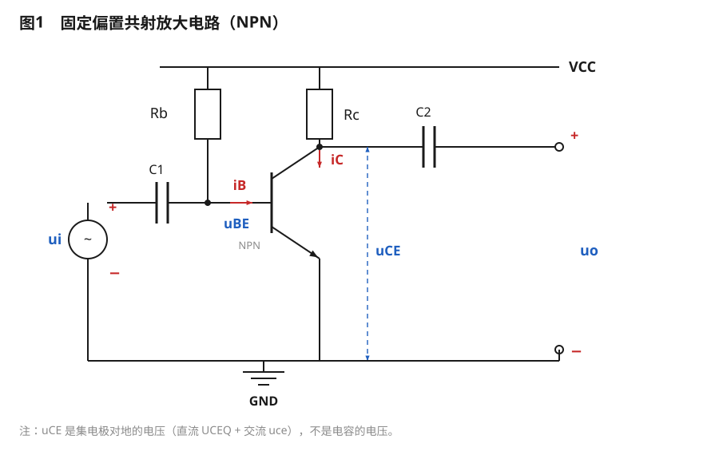
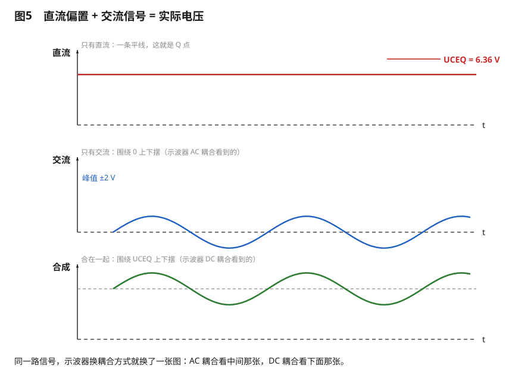
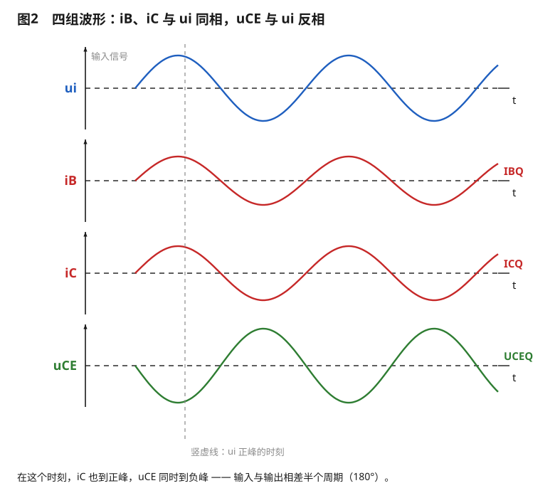
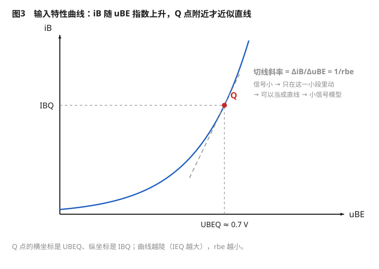
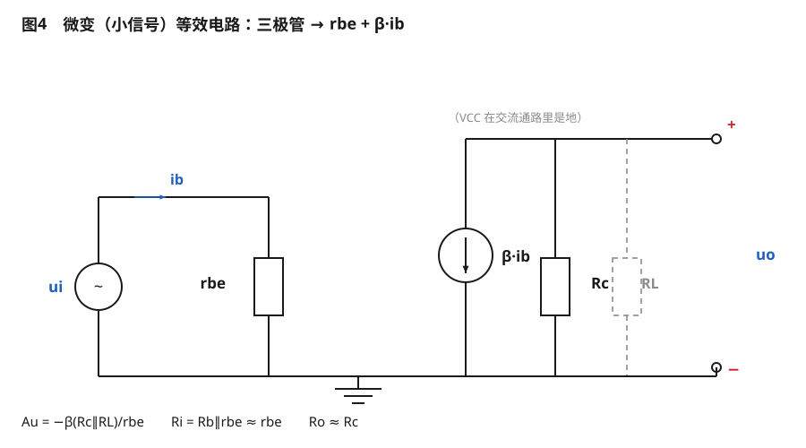
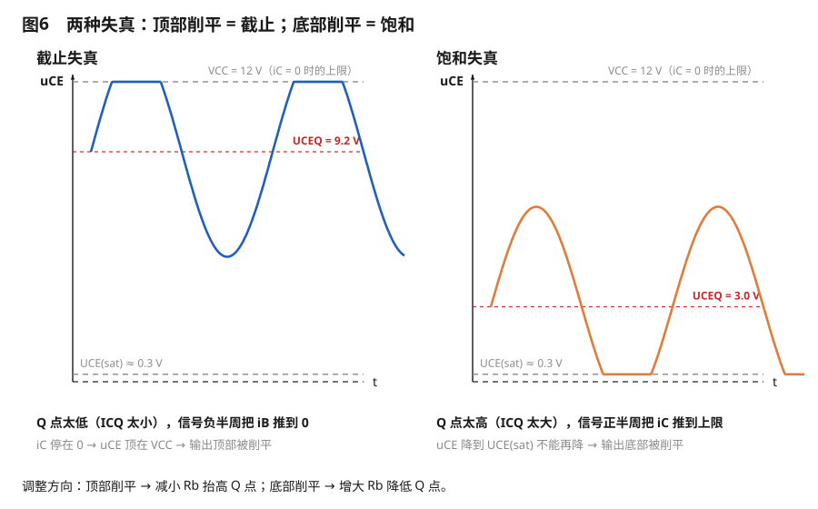

# 01 · 基本放大电路（我自己能看懂的版本）

> 这篇是写给自己的，不是写给别人看的。**遇到看不懂的地方我就停下来解释，公式都从最基础的地方推。**
> 前置：先看 [00-基础补课](00-基础补课.md)，里面的欧姆定律、KVL、大小写约定、三极管三个区，后面会反复用。

---

## 0. 一页结论（复习时只看这里）

| 问题 | 我的答案 |
|---|---|
| 这是什么电路 | NPN 三极管 + 固定偏置电阻 Rb + 集电极电阻 Rc + 两个耦合电容 |
| 放大的本质 | 三极管待在**放大区**，满足 `iC = β·iB`，基极的小电流放大成集电极的大电流 |
| 直流部分做什么 | 把 Q 点（IBQ、ICQ、UCEQ）摆好，让三极管一直待在放大区 |
| 交流部分做什么 | 在 Q 点上下浮动，浮动被放大，再从 Rc 上取出来 |
| 三个公式 | `IBQ=(VCC−UBEQ)/Rb`，`ICQ=β·IBQ`，`UCEQ=VCC−ICQ·Rc` |
| 一个增益 | `Au = −β(Rc∥RL)/rbe`，负号表示**反相 180°** |
| 一句话 | **偏置定 Q 点，Rc 把电流变成电压，C1/C2 隔直通交，共射必反相。** |

---

## 1. 先认电路：图上有两个"圈"



### 1.1 这张图其实只有两个回路

我第一次看图的时候一片乱，后来发现只要抓两个圈就够了：

```
输入回路：VCC → Rb → 基极 B → 发射结（B→E）→ 地 → 回 VCC
输出回路：VCC → Rc → 集电极 C → 发射结（C→E，也就是 uCE）→ 地 → 回 VCC
```

- **输入回路**决定基极电流有多少 → 决定 Q 点。
- **输出回路**决定集电极电压是多少 → 决定输出信号。

后面算 Q 点，就是把这两个圈各写一个电压等式；算增益，就是把这两个圈"只保留交流"再写一次。

### 1.2 每个元件在干什么（用我自己的话说）

| 元件 | 位置 | 我自己的理解 | 拿掉会怎样 |
|---|---|---|---|
| **VCC** | 电源 | 提供能量，也是直流的来源 | 没有偏置，三极管不工作 |
| **Rb** | VCC → 基极 | 像水龙头的"开度旋钮"，决定基极电流多大 | 基极没电流，三极管截止 |
| **Rc** | VCC → 集电极 | **最关键的一个**：把"电流变化"翻译成"电压变化" | 集电极直接接电源，uCE 恒等于 VCC，输出一点都不会动 |
| **C1** | 信号源 → 基极 | 把信号源送进来的**交流**放过去，把它带的**直流**挡住 | 信号源的内阻会把 Q 点搞乱 |
| **C2** | 集电极 → 负载 | 把输出的**交流**送出去，把集电极那几伏**直流**挡住 | 负载会把 UCEQ 拉低，Q 点跑掉 |
| **三极管** | 核心 | 基极电流控制集电极电流：`iC = β·iB` | 什么都不放大 |
| **GND** | 公共端 | 输入和输出的公共参考点——"共射"的"共"就指这个 | 没有参考点 |

### 1.3 三个必须记住的节点

- **B（基极）**：电压 `uBE` 相对地，正常约 0.7 V。
- **C（集电极）**：电压 `uCE` 相对地，正常约几伏（Q 点）。
- **E（发射极）**：接地，所以发射极电压是 0 V。

> 图上标的 `uC`（有的板书写成 `uCa`）就是**集电极对地的电压，也就是 uCE**。它不是电容的电压，别搞混。

---

## 2. 直流部分：先把 Q 点摆好

### 2.1 为什么非得先有直流

三极管只有在**放大区**（发射结正偏、集电结反偏）才能放大。这个状态不会自己出现——必须由外部直流"喂"一个合适的基极电流。

输入信号 ui 只有几十毫伏，它自己根本撑不起这个工作点。它的任务只是**在已经摆好的位置上，上下再动一点点**。

所以顺序永远是：**先用直流摆好 Q 点 → 再让交流信号在这上面浮动**。

### 2.2 直流通路：把电容当断路

分析静态时：

- C1、C2 对直流相当于**断开**（充满电后没有电流）；
- 交流信号源 ui 置零。

剩下的就是：VCC、Rb、Rc、三极管、地。这就是**直流通路**。

### 2.3 一步一步算 IBQ

从输入回路出发，沿圈走一圈（用 KVL）：

```
VCC = iB·Rb + uBE
```

没有信号时，`iB = IBQ`、`uBE = UBEQ`，代入：

```
VCC = IBQ·Rb + UBEQ
IBQ = (VCC − UBEQ) / Rb
```

**这个式子每一部分的意思：**
- VCC 是总电压；
- UBEQ 是发射结导通压降（硅管约 0.7 V，就是二极管的正向压降）；
- 剩下的 `VCC − UBEQ` 全部落在 Rb 上，所以 `IBQ = 落下来的电压 / 电阻`——就是欧姆定律。

### 2.4 接着算 ICQ 和 UCEQ

```
ICQ = β·IBQ
```

从输出回路走一圈：

```
VCC = iC·Rc + uCE
```

静态时：

```
UCEQ = VCC − ICQ·Rc
```

**理解这个式子**：VCC 是总电压，ICQ 在 Rc 上压掉一部分（`ICQ·Rc`），剩下的才落在集电极和发射极之间，就是 UCEQ。

### 2.5 手算一遍（数字具体，带单位）

题目：`VCC = 12 V，Rb = 300 kΩ，Rc = 3 kΩ，β = 50，UBEQ = 0.7 V`

**第 1 步：IBQ**

```
IBQ = (12 − 0.7) / 300 000
    = 11.3 / 300 000
    = 0.0000377 A
    = 37.7 μA
```

**第 2 步：ICQ**

```
ICQ = 50 × 37.7 μA = 1885 μA ≈ 1.88 mA
```

**第 3 步：UCEQ**

```
UCEQ = 12 − 1.88 mA × 3 kΩ
     = 12 − 5.64
     = 6.36 V
```

**第 4 步：检查是不是在放大区**

- UCEQ = 6.36 V，远大于饱和压降 0.3 V，说明没饱和；
- 基极 0.7 V，集电极 6.36 V，集电结是反偏的，说明在放大区。✅

> 算完必看量级：IBQ 应该在几十 μA，ICQ 在几 mA，UCEQ 在几伏。如果算出负数或者几百伏，一定是单位没换。

---

## 3. 交流部分：信号进来以后

### 3.1 C1 怎么把信号送进来

C1 隔直通交：

- 信号源自带的直流被 C1 挡住 → **Q 点不受信号源影响**；
- ui 的交流部分可以"穿过去" → 加到基极上。

所以基极电压实际是：

```
uBE = UBEQ + ube ≈ 0.7 V + ui
```

### 3.2 交流通路：电容短路，VCC 接地

分析动态时：

- 电容对交流相当于**短路**；
- **VCC 相当于接地**（理想电源电压恒定不变，对交流来说没有电压变化，就等价于一根接地线）。

于是：
- Rb 的上端变成接地；
- Rc 的上端变成接地；
- 基极和地之间是 `Rb ∥ rbe`；
- 集电极和地之间是 `Rc ∥ RL`（如果接了负载）。

### 3.3 从 ui 到 uo 的连锁反应

按顺序看，每一步只用一个关系：

```
ui 变大
  → ube 变大（信号直接加在基极上）
  → ib 变大（输入特性曲线：uBE 大一点，iB 就大一点）
  → ic 变大（三极管的放大作用：ic = β·ib）
  → Rc 上的压降 ic·Rc 变大
  → 集电极剩下的电压 uCE = VCC − ic·Rc 变小
  → uo 变小
```

**注意最后一步**：输入变大，输出反而变小。**这就是反相。**

### 3.4 为什么是 180°，用公式确认

输出回路：

```
uCE = VCC − Rc·iC
```

VCC 是常数，两边只看变化量：

```
ΔuCE = −Rc·ΔiC
```

而：

```
ΔiC = β·ΔiB
```

所以：

```
ΔuCE = −β·Rc·ΔiB
```

- `ΔiB` 与 `Δui` 同号（输入变大，基极电流变大）；
- 但前面有个**负号**，所以 `ΔuCE` 与 `Δui` 反号 → 相位差 180°。

**物理上怎么理解**：Rc 就是一段固定的阻力。电流变大了，这段阻力上"吃掉"的电压就更多，留给集电极的电压自然更少。**负号不是三极管产生的，是 Rc 产生的。**

> 验证方法：共集（射极跟随器）没有 Rc 在集电极，输出就与输入同相；共基也是同相。**只有共射反相。**

---

## 4. 波形：为什么都围着 Q 点上下摆

### 4.1 实际电压 = 直流 + 交流



以 uCE 为例：

```
uCE = UCEQ + uce = 6.36 V + 交流成分
```

所以示波器上看到的是**一条中心在 6.36 V、上下摆动的波形**，不是"一条在 0 V 上下摆的波形"。

**示波器设置会影响观感**：

| 耦合方式 | 看到什么 |
|---|---|
| **DC 耦合** | 完整的 uCE：中心在 6.36 V，波形整体被抬高 |
| **AC 耦合** | 只看到交流部分 uce：中心在 0 V |

两种都是对的，只是滤掉了直流。**如果 AC 耦合时波形中心不在 0，或者 DC 耦合时波形贴着屏幕底/顶，先检查耦合方式和垂直档位。**

### 4.2 四组波形一起看



| 量 | 围绕的值 | 与 ui 的相位 | 幅度 |
|---|---|---|---|
| uBE | UBEQ ≈ 0.7 V | 同相 | 很小（就是 ui 的幅度） |
| iB | IBQ ≈ 37.7 μA | 同相 | `ib = ube / rbe` |
| iC | ICQ ≈ 1.88 mA | 同相（与 iB 同相） | `ic = β·ib`，放大 β 倍 |
| uCE | UCEQ ≈ 6.36 V | **反相 180°** | `uce = −Rc·ic` |

**逐个确认相位**：

- **iB 与 ui 同相**：输入特性曲线是单调上升的，uBE 变大 → iB 就变大，没有反向。
- **iC 与 iB 同相**：`iC = β·iB`，β 是正数，方向不变。
- **uCE 与 iC 反相**：`uCE = VCC − Rc·iC`，负号在这儿。

### 4.3 示波器上怎么真的看到它们

| 想测 | 怎么接 | 注意事项 |
|---|---|---|
| ui | CH1 探针接输入端，接地夹接 GND | 注意探头 ×1/×10 和垂直档位 |
| uo（就是 uCE） | CH2 探针接集电极，接地夹接 GND | 用 DC 耦合才能看到它绕 UCEQ 摆 |
| iC | 在 Rc 上串一个 100 Ω 小电阻，测它两端电压再除以 100 Ω | 串了电阻会稍微改变 Q 点，心里要有数 |
| iB | 在基极串 1 kΩ 电阻测压降，或者用仿真看 | 量级只有几十 μA，探头负载会影响结果 |

**双通道看相位**：CH1 接 ui、CH2 接 uo，把两条波形的过零点对齐，会看到**一条在峰时另一条在谷**——这就是 180°。

---

## 5. rbe：输入特性的"斜率"是怎么变成电阻的



### 5.1 输入特性曲线是什么

把 uBE 从 0 慢慢加大，测 iB 的变化，画出来是这样一条**指数型曲线**：

- uBE 小于 0.5 V 左右，iB 几乎为 0（截止）；
- uBE 过了 0.7 V 附近，iB 急剧上升；
- 它**不是直线**，所以"电压和电流成正比"在这里不成立。

### 5.2 小信号为什么可以当直线

如果信号幅度很小，工作点只在 Q 点附近**一小段**曲线里来回移动——这一小段可以近似看成直线。

这条直线的斜率：

```
斜率 = ΔiB / ΔuBE = 1 / rbe
```

所以 `rbe = ΔuBE / ΔiB`，单位是 Ω——**从基极看进去的等效电阻**。

**这也是"小信号模型"的本质**：信号足够小 → 曲线的一小段 ≈ 直线 → 三极管可以当成线性元件。

### 5.3 rbe 的估算公式

```
rbe = rbb' + (1 + β)·26 mV / IEQ
```

拆开看：

- `26 mV / IEQ`：发射结的动态电阻 `re`（26 mV 是热电压 UT，室温下的常数）；
- `(1 + β)·re`：从基极往里看，电流被放大了 (1+β) 倍，电阻也跟着放大；
- `rbb'`：基区体电阻，一般取 200~300 Ω。

代入例题（IEQ ≈ ICQ = 1.88 mA）：

```
re  = 26 mV / 1.88 mA ≈ 13.8 Ω
rbe = 200 + 51 × 13.8 ≈ 200 + 705 = 905 Ω
```

**记住这个趋势**：IEQ 越大，rbe 越小，增益越大——但线性范围也越小，越容易饱和。**这是放大电路里永恒的矛盾：增益和失真不能同时最优。**

---

## 6. 等效电路：把三极管换成两个元件



### 6.1 为什么可以这样换

在 Q 点附近，三极管的表现可以"简化"成两个元件：

- **输入端**：一个电阻 `rbe`（因为 ΔuBE = rbe·ΔiB）；
- **输出端**：一个受控电流源 `β·ib`（因为 ΔiC = β·ΔiB，且与 uCE 基本无关）。

于是复杂的非线性器件变成了一个"电阻 + 受控源"的线性电路，可以像普通电路一样算。

> 这一步的合法性完全依赖"信号小"。信号一大，就跑出那段直线，等效就不准了。

### 6.2 算电压增益 Au

输出端：电流 `ic` 从集电极流向发射极，在 `Rc ∥ RL` 上产生电压。

```
uo = −ic · (Rc ∥ RL)
```

负号的原因：电流增大时，集电极电压下降（和前面一样）。

输入端：

```
ui = ib · rbe
```

代入 `ic = β·ib`：

```
Au = uo / ui = −β·(Rc ∥ RL) / rbe
```

**代数字**（RL = 3 kΩ）：

```
Rc ∥ RL = 3k ∥ 3k = 1.5 kΩ
Au = −50 × 1500 / 905 ≈ −82.9
```

空载时（不接 RL，Rc ∥ RL 就是 Rc = 3 kΩ）：

```
Au = −50 × 3000 / 905 ≈ −166
```

> 结论：**接了负载，增益掉一半。** 负载越重（RL 越小），掉得越多。

### 6.3 算输入电阻 Ri

从输入端往里看，基极有两条路通到地（交流地）：

1. 经 Rb 到地（VCC 在交流通路里是地）；
2. 经发射结到地（这条路等效为 rbe）。

两条路并联：

```
Ri = Rb ∥ rbe ≈ 905 Ω（因为 300 kΩ 远大于 905 Ω）
```

**为什么要在意 Ri**：Ri 越小，信号源"带不动"——它会从信号源抽取更多电流，信号源的输出电压就被拉低了。

### 6.4 算输出电阻 Ro

求 Ro 的方法：把输入信号置 0（ui = 0），从输出端往里看。

- ui = 0 → ib = 0 → 受控电流源 `β·ib = 0`，相当于开路；
- 从输出端看进去，只剩 Rc 一条路到地。

```
Ro ≈ Rc = 3 kΩ
```

**为什么要在意 Ro**：Ro 越大，带负载能力越差（接上负载，输出电压就被分掉一部分）。这就是共射"接负载增益就掉"的根本原因。

### 6.5 三项指标放一起

```
Au = −β(Rc∥RL) / rbe      （负号 = 反相）
Ri = Rb ∥ rbe ≈ rbe        （小）
Ro ≈ Rc                    （大）
```

---

## 7. 失真：波形被"削平"是什么样子



### 7.1 截止失真：Q 点太低

**机理**：iB 只能大于等于 0，不能是负数。如果 Q 点太低，输入信号的负半周会把 iB 推到 0 以下——推不动了，就"削平"。

- iB、iC 的**负半周**被削平；
- 集电极电流变小 → uCE 变大 → uCE 的**正半周**被削平（顶在 VCC 附近）。

**现象**：输出波形**顶部**是平的。
**怎么调**：Q 点太低 → 需要更大 IBQ → **减小 Rb**。

### 7.2 饱和失真：Q 点太高

**机理**：iC 最大只能到 `VCC/Rc`（此时 uCE 降到 0.3 V 左右，进饱和区）。如果 Q 点太高，输入信号的正半周会把 iC 推到这个上限——推不动了，就削平。

- iC 的**正半周**被削平；
- uCE 的**负半周**被削平（贴在 0.3 V 附近）。

**现象**：输出波形**底部**是平的。
**怎么调**：Q 点太高 → 需要更小 IBQ → **增大 Rb**。

### 7.3 判别口诀

```
看输出 uo：
  顶部平了 → 截止失真 → Q 点低 → 减 Rb
  底部平了 → 饱和失真 → Q 点高 → 增 Rb
  上下都平 → 信号太大 → 减小输入
（NPN 共射，记住"顶截底饱"）
```

> 千万注意：**波形"上下颠倒"不是失真**。反相是正常现象，变成一条直线（削平）才是失真。

---

## 8. 这个电路的问题（下一章要解决）

固定偏置的 Q 点是"靠 β 和 0.7 V 撑起来的"，可这两个量都不老实：

| 温度升高 | 会发生什么 |
|---|---|
| UBEQ 下降（约 −2 mV/℃） | IBQ 变大 |
| β 变大 | ICQ 变得更大 |
| 漏电流 ICBO 变大 | ICQ 再变大 |

三件事一起发生：ICQ 越来越大 → Q 点越来越高 → 越来越容易饱和失真。

**改进思路**（下一章）：分压式偏置 + 发射极电阻 Re，用 Re 上的直流负反馈把 ICQ 稳住，让 Q 点不再看 β 的脸色。

> 顺带记一笔：以后做芯片测试时，这一章对应的是 **DC 参数测试**（测 IB、IC、β、UCE(sat)）和 **AC 测试**（增益、带宽）。现在把 Q 点算明白，以后看 datasheet 的测试条件（VCC、温度、负载）就不会一头雾水。

---

## 9. 我自己的话总结

```
1. 放大器 = 直流偏置 + 交流信号，两件事分开算。
2. 直流算三个数：IBQ、ICQ、UCEQ —— 都是 KVL 加欧姆定律。
3. 交流算三件事：Au、Ri、Ro —— 都是"把三极管换成 rbe + β·ib"。
4. 反相来自 Rc：uCE = VCC − Rc·iC。
5. 失真 = 三极管跑出了放大区，波形被削平；顶部平是截止，底部平是饱和。
```

---

## 10. 自测（答不上来，回看括号里的那一节）

**Q1.** VCC = 15 V、Rb = 470 kΩ、Rc = 4.7 kΩ、β = 80、UBEQ = 0.7 V，求三个 Q 点参数。（第 2 节）
<details><summary>答案</summary>

IBQ = (15−0.7)/470k = 30.4 μA；
ICQ = 80 × 30.4 μA = 2.43 mA；
UCEQ = 15 − 2.43m × 4.7k ≈ 15 − 11.4 = 3.6 V（仍在放大区）。

</details>

**Q2.** 把 Rb 从 300 kΩ 改成 150 kΩ，Q 点怎么变？（第 2、7 节）
<details><summary>答案</summary>

IBQ 翻倍 → ICQ 翻倍 → UCEQ 大幅下降，Q 点上移，更容易饱和失真（底部先削平）。

</details>

**Q3.** 为什么交流通路里 VCC 要接地？（第 3.2 节）
<details><summary>答案</summary>

理想电压源端电压恒定，对交流来说没有电压变化，两端等价于短路到地。

</details>

**Q4.** 为什么共射输出反相，而共集同相？（第 3.4 节）
<details><summary>答案</summary>

共射：uo 从 Rc 上取，电流增大时 Rc 压降增大，集电极电压下降 → 反相。
共集：uo 从发射极电阻上取，电流增大时发射极电压上升 → 同相。

</details>

**Q5.** 接了 3 kΩ 负载后 Au 从 −166 掉到 −82.9，为什么？（第 6.2 节）
<details><summary>答案</summary>

交流通路里 RL 与 Rc 并联，等效电阻变成 1.5 kΩ，增益与这个并联值成正比。

</details>

**Q6.** 示波器 DC 耦合看到 uCE 中心在 6.36 V，换成 AC 耦合中心跑到 0 V，正常吗？（第 4.1 节）
<details><summary>答案</summary>

正常。AC 耦合把直流成分滤掉了，只剩交流分量。

</details>

**Q7.** 想让输出波形居中、正负摆幅一样大，Q 点应该取在哪？（第 7 节）
<details><summary>答案</summary>

取在交流负载线的中点，即 UCEQ ≈ (VCC + UCE(sat))/2 附近，同时保证 ICQ·(Rc∥RL) 也够大。

</details>

---

## 11. 我卡住过的地方（FAQ）

**Q：为什么 Rb 接到 VCC，而不是接到地？**
A：固定偏置就是用 VCC 经 Rb 往基极灌电流，所以 Rb 上端接 VCC。如果 Rb 接在基极和地之间，那基极电压会被拉到 0，三极管直接截止。

**Q：为什么不能省掉 Rc？**
A：没有 Rc，集电极直接接 VCC，uCE 永远是 VCC，集电极电流再怎么变，输出端电压都不变——没有电压输出，就没有放大。

**Q：为什么 UCEQ 一般取 VCC 的一半左右？**
A：为了正负摆幅对称，波形上下都能摆到边界才不失真。取一半是"最大不失真输出"的粗略做法。

**Q：为什么 iB 只有几十 μA，ic 却有几 mA？**
A：这就是三极管的放大作用，`ic = β·ib`，β 有几十到几百。

**Q：小信号模型里的"小"到底要多小？**
A：小到信号在输入特性曲线上只占很短一段、近似直线。经验上 ube 在几 mV 到十几 mV 量级时误差可接受；信号大了就必须回到图解法或考虑失真。

**Q：C1 会不会影响低频？**
A：会。容抗 `XC = 1/(2πfC)` 随频率降低而增大，低频时不再是"短路"，增益会下降。这就是频率响应的伏笔。

---

## 12. 复习记录

| 日期 | 轮次 | 结果 |
|---|---|---|
| 2026-11-21 | 第 1 轮 | 建立笔记（个人版） |
|  | 第 2 轮（+1 天） |  |
|  | 第 3 轮（+7 天） |  |
|  | 第 4 轮（+30 天） |  |
